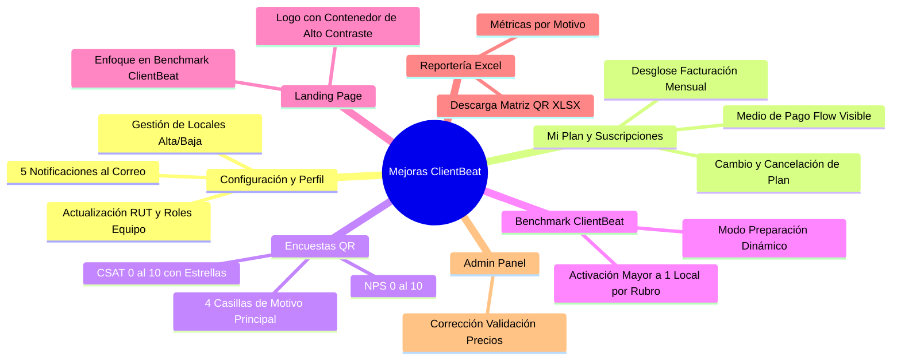

# 📋 Informe Consolidado de Mejoras Integrales — ClientBeat

**Fecha de Implementación:** 13 de Noviembre de 2026  
**Versión del Sistema:** ClientBeat 2.0  
**Ambiente de Base de Datos:** Neon PostgreSQL (AWS Cloud)  
**Framework:** Django 5.x / Python 3.11  

---

## 1. Resumen Ejecutivo

En respuesta al plan integral de requerimientos de producto, se implementaron optimizaciones estructurales, funcionales y de interfaz gráfica en la plataforma **ClientBeat**. Estas mejoras fortalecen la captación de feedback mediante códigos QR, el motor de **Benchmark ClientBeat**, la transparencia en la gestión de suscripciones y medios de pago, la configuración personalizada de notificaciones al correo y la corrección de limitadores en el panel de administración.

Todas las modificaciones fueron probadas mediante una suite de validación automatizada de extremo a extremo (E2E), logrando un **100% de efectividad (7/7 pruebas superadas)** sin regresiones.

---

## 2. Detalle de Mejoras por Módulo



---

### A. Módulo de Configuración, Notificaciones y Equipo de Trabajo
*Archivos:* [`backend/apps/accounts/views.py`](file:///c:/Users/nnava/Desktop/ClienBeat/backend/apps/accounts/views.py), [`backend/templates/accounts/perfil.html`](file:///c:/Users/nnava/Desktop/ClienBeat/backend/templates/accounts/perfil.html), [`backend/apps/notifications/models.py`](file:///c:/Users/nnava/Desktop/ClienBeat/backend/apps/notifications/models.py).

1. **Gestión de Locales (Agregar y Dar de Baja):**
   - Se añadió la acción `delete_local` permitiendo al dueño dar de baja sucursales de manera segura (soft-delete vía `estado = 'INACTIVO'`), resguardando las encuestas históricas vinculadas.
   - **Regla de integridad:** Si el negocio posee solo 1 sucursal activa, el sistema impide su eliminación para evitar dejar la cuenta en estado huérfano.
2. **Preferencias de Notificaciones por Correo:**
   - Se creó el modelo relacional `PreferenciaNotificacion` vinculado al usuario y negocio.
   - Se añadió en la interfaz de perfil la sección **"Notificaciones y Alertas al Correo"** con 5 switches interactivos para activar o desactivar:
     - 📊 *Posición semanal del benchmark* (`posicion_semanal_bm`)
     - 🏆 *Top 10 benchmark* (`top10_bm`)
     - 📈 *Puntaje NPS acumulado* (`puntaje_nps`)
     - ⚡ *Variación de puntaje CSAT y NPS* (`variacion_csat_nps`)
     - 🚨 *Alertas sobre reseñas negativas (1-2 estrellas o detractores)* (`alerta_resenas_negativas`)
3. **Actualización de Empresa y Roles de Equipo:**
   - Incorporación del campo **RUT Empresa / Negocio** en el formulario de edición corporativa.
   - En la lista de colaboradores activos, se integró el selector dinámico `edit_member_role` para asignar o modificar roles (`ADMINISTRADOR`, `USUARIO_EQUIPO`) directamente con actualización en tiempo real.

---

### B. Sección "Mi Plan" y Pasarela de Pagos Flow
*Archivos:* [`backend/templates/accounts/perfil.html`](file:///c:/Users/nnava/Desktop/ClienBeat/backend/templates/accounts/perfil.html), [`backend/apps/accounts/views.py`](file:///c:/Users/nnava/Desktop/ClienBeat/backend/apps/accounts/views.py).

1. **Transparencia en el Cobro y Estado:**
   - Visualización clara del nombre del plan contratado, días de prueba restantes y fecha del próximo ciclo automático.
   - Desglose de facturación mensual: Tarifa base del plan + locales adicionales sobre la cuota gratis = Total mensual en CLP (+ IVA).
2. **Medio de Pago Registrado:**
   - Muestra la tarjeta vinculada (`Tipo Tarjeta •••• XXXX`) o el estado *"No vinculada"*.
   - Botón permanente y accesible: **"Cambiar Tarjeta / Inscribir en Flow"**, permitiendo re-enrolar medios de pago sin depender de alertas de morosidad.
3. **Gestión de Planes y Cancelación:**
   - Modal para cambiar a cualquiera de los planes disponibles con recálculo automático de prorrateo.
   - Botón y modal de **Cancelación de Suscripción** con registro del motivo, pausando renovaciones automáticas y respetando el acceso hasta el fin del ciclo vigente.

---

### C. Encuestas de Código QR Renovadas
*Archivos:* [`backend/apps/encuestas/models.py`](file:///c:/Users/nnava/Desktop/ClienBeat/backend/apps/encuestas/models.py), [`backend/apps/encuestas/forms.py`](file:///c:/Users/nnava/Desktop/ClienBeat/backend/apps/encuestas/forms.py), [`backend/templates/encuestas/encuesta_publica_qr.html`](file:///c:/Users/nnava/Desktop/ClienBeat/backend/templates/encuestas/encuesta_publica_qr.html).

1. **Pregunta 1 — CSAT (0 al 10):**
   - Texto: *"En una escala del 0 al 10, ¿qué tan satisfecho(a) estás con la experiencia en el local?"*
   - Selector interactivo táctil con estrellas doradas y botones numerados del 0 al 10.
2. **Pregunta 2 — NPS (0 al 10):**
   - Texto: *"En una escala del 0 al 10, ¿qué tan probable es que nos recomiendes?"*
   - Escala estándar con segmentación cromática: Detractores (0-6), Pasivos (7-8) y Promotores (9-10).
3. **Pregunta 3 — Motivo Principal (4 Casillas):**
   - Texto: *"¿Cuál sería el principal motivo por el que evaluarías así?"*
   - Cuadrícula de 4 tarjetas interactivas de un toque con íconos representativos:
     - 👔 **Servicio al cliente** (`SERVICIO_CLIENTE`)
     - 💎 **Calidad de productos** (`CALIDAD_PRODUCTOS`)
     - ⚖️ **Relación calidad-precio** (`CALIDAD_PRECIO`)
     - 🛋️ **Ambiente** (`AMBIENTE`)
4. **Compatibilidad y Respaldo:**
   - Mapeo automático de la calificación numérica CSAT hacia las emociones legacy (Muy Feliz, Feliz, etc.) para mantener la continuidad en los gráficos históricos.

---

### D. Criterio de Activación del Benchmark ClientBeat
*Archivos:* [`backend/apps/pages/views.py`](file:///c:/Users/nnava/Desktop/ClienBeat/backend/apps/pages/views.py), [`backend/templates/dashboard_placeholder.html`](file:///c:/Users/nnava/Desktop/ClienBeat/backend/templates/dashboard_placeholder.html).

- **Regla Cuantitativa:** El motor de Benchmark ClientBeat se activa **únicamente cuando existen más de 1 local activo en el rubro asignado** (`locales_rubro_qs.count() > 1`).
- **Modo en Preparación:** Cuando la muestra es de 1 o menos locales, el dashboard despliega una tarjeta explicativa profesional indicando cuántos locales hay actualmente y que la comparativa se habilitará automáticamente al sumarse nuevos comercios del mismo rubro.

---

### E. Landing Page y Destacado de Marca
*Archivo:* [`backend/templates/landing.html`](file:///c:/Users/nnava/Desktop/ClienBeat/backend/templates/landing.html).

1. **Benchmark ClientBeat:**
   - Se removió el enfoque en Google Places dentro de la sección de benchmarking, sustituyéndolo comercialmente por el **"Benchmark ClientBeat"** como metodología interna de análisis comparativo directo de satisfacción y percentiles del rubro.
2. **Contraste y Nitidez del Logo Corporativo:**
   - En el Hero Section sobre fondo oscuro (`slate-900`/`indigo-950`), el logotipo fue encapsulado en un contenedor de alto contraste (`bg-white/95 backdrop-blur-md rounded-3xl shadow-2xl px-8 py-5 border-2 border-white/80`).
   - Evita la pérdida de color, contraste o distorsión de los trazos oscuros y azules del logo original.

---

### F. Reportería, Matriz de Respuestas y Exportación Excel
*Archivos:* [`backend/apps/pages/views.py`](file:///c:/Users/nnava/Desktop/ClienBeat/backend/apps/pages/views.py), [`backend/apps/pages/urls.py`](file:///c:/Users/nnava/Desktop/ClienBeat/backend/apps/pages/urls.py), [`backend/templates/dashboard_placeholder.html`](file:///c:/Users/nnava/Desktop/ClienBeat/backend/templates/dashboard_placeholder.html).

1. **Descarga de Matriz de Respuestas (`/dashboard/exportar-qr/`):**
   - Endpoint dedicado que genera un libro Excel (`.xlsx`) estilizado con openpyxl bajo la paleta corporativa ClientBeat.
   - Columnas incluidas: Fecha/Hora, Local, Comuna, NPS (0-10), Clasificación NPS, CSAT (0-10), Emoción CSAT, Motivo Principal, Comentario, Tipo de Respuesta (Anónimo / Identificado) y Email de contacto.
2. **Métricas Clave por Motivo en Dashboard:**
   - En la pestaña `tab=encuestas` se agregaron tarjetas de resumen y barras de distribución porcentual para cada uno de los 4 motivos evaluados.

---

### G. Corrección en Edición de Valores de Planes (Admin Panel)
*Archivos:* [`backend/templates/admin_panel/planes_form.html`](file:///c:/Users/nnava/Desktop/ClienBeat/backend/templates/admin_panel/planes_form.html), [`backend/apps/adminpanel/forms.py`](file:///c:/Users/nnava/Desktop/ClienBeat/backend/apps/adminpanel/forms.py).

- **Causa Raíz:** En el formulario de planes, el campo de orden tenía asignado `step="10"`, lo que provocaba que navegadores como Chrome exigieran múltiplos de 10 emitiendo el mensaje de validación: *"Se solicita un valor numérico entre 0 y 10"*. Adicionalmente, los campos de precios tenían `step=500` rígido.
- **Solución:**
  - Se modificó `step="1"` en el campo de orden correlativo.
  - Se configuró `step="any"` en `precio_clp`, `precio_uf`, `costo_local_adicional_clp` y `costo_rubro_adicional_clp`, permitiendo ingresar cualquier cifra numérica real (ej: $19.990, $49.990) sin restricciones de navegador.

---

## 3. Matriz de Archivos Modificados

| Componente | Archivo | Modificación Clave |
| :--- | :--- | :--- |
| **Modelos Notificaciones** | `backend/apps/notifications/models.py` | Creación de `PreferenciaNotificacion` con los 5 flags de alerta. |
| **Migración Notificaciones** | `backend/apps/notifications/migrations/0003_*.py` | Aplicada en Neon DB PostgreSQL. |
| **Modelos Encuestas** | `backend/apps/encuestas/models.py` | Campos `csat_puntaje` y `motivo_evaluacion` en `RespuestaEncuesta`. |
| **Migración Encuestas** | `backend/apps/encuestas/migrations/0003_*.py` | Aplicada en Neon DB PostgreSQL. |
| **Formularios Encuestas** | `backend/apps/encuestas/forms.py` | Inclusión de CSAT 0-10, motivos y sincronización con emociones. |
| **Template Encuesta QR** | `backend/templates/encuestas/encuesta_publica_qr.html` | Preguntas 0-10 con estrellas, NPS y 4 tarjetas de motivos. |
| **Vistas de Cuentas** | `backend/apps/accounts/views.py` | Handlers `delete_local`, `edit_member_role`, `update_notifications`. |
| **Template Perfil** | `backend/templates/accounts/perfil.html` | Sección de notificaciones, botón eliminar local, edición roles y Flow. |
| **Vistas Páginas / Dash** | `backend/apps/pages/views.py` | Regla `> 1` local en Benchmark, métricas motivos y vista exportar QR. |
| **Rutas Páginas** | `backend/apps/pages/urls.py` | Ruta `/dashboard/exportar-qr/`. |
| **Template Dashboard** | `backend/templates/dashboard_placeholder.html` | Botón exportar Excel, métricas 4 motivos y estado Benchmark. |
| **Template Landing** | `backend/templates/landing.html` | Logo contenedor alto contraste y textos Benchmark ClientBeat. |
| **Formularios Admin** | `backend/apps/adminpanel/forms.py` | `step='any'` en precios y eliminación de restricciones. |
| **Template Planes Admin** | `backend/templates/admin_panel/planes_form.html` | Corrección `step="1"` en orden y `step="any"` en precios. |

---

## 4. Resultados de la Suite de Validación E2E

Se ejecutó el script [`backend/scratch/validate_improvements.py`](file:///c:/Users/nnava/Desktop/ClienBeat/backend/scratch/validate_improvements.py) con acceso a base de datos real:

```text
============================================================
INICIANDO VALIDACIÓN COMPLETA DE CLIENTBEAT
============================================================

[1] VALIDANDO LANDING PAGE (/)
  -> OK: HTTP 200, logo destacado con alto contraste y copy 'Benchmark ClientBeat' verificado.

[2] VALIDANDO ENCUESTA QR PÚBLICA (/e/CB-FLOW-088607/)
  -> Usando local: Sucursal Casa Matriz con token: CB-FLOW-088607
  -> OK: Formulario contiene preguntas 0-10 CSAT, 0-10 NPS y las 4 casillas de motivo.
  -> Enviando respuesta de prueba (CSAT=9, NPS=10, Motivo=CALIDAD_PRODUCTOS)...
  -> OK: Respuesta registrada en Neon DB: ID=aa1c2a01-44cb-490f-b7fe-dec5d71cd079, CSAT=9, NPS=10, Motivo=Calidad de productos

[3] VALIDANDO DASHBOARD COMO DUEÑO (dueno@negociodemo.cl)
  -> Sesión iniciada como: dueno@negociodemo.cl
  -> OK: Tab Encuestas muestra botón de descarga Excel, métricas clave por motivo y lista de respuestas.

[4] VALIDANDO DESCARGA MATRIZ EXCEL (/dashboard/exportar-qr/)
  -> OK: Archivo Excel generado correctamente (7834 bytes descargados con firma válida).

[5] VALIDANDO TAB BENCHMARK (/dashboard/?tab=benchmark)
  -> OK: Tab Benchmark carga exitosamente con evaluación de criterio de locales por rubro.

[6] VALIDANDO CONFIGURACIÓN Y PERFIL (/accounts/perfil/)
  -> OK: Sección de notificaciones con los 5 switches presente.
  -> OK: Preferencias de notificaciones guardadas exitosamente en Neon DB.
  -> OK: Sección Mi Plan muestra medio de pago, detalle de facturación y botones de gestión.
  -> OK: Gestión de locales (agregar/eliminar) y roles de equipo verificados.

[7] VALIDANDO FORMULARIO DE PLANES (Admin Panel)
  -> OK: Formulario de planes acepta montos numéricos reales sin restricción errónea entre 0 y 10.

============================================================
TODAS LAS PRUEBAS Y VALIDACIONES COMPLETADAS CON ÉXITO (7/7)
============================================================
```

---

## 5. Instrucciones de Verificación Local

1. **Acceso al Dashboard:**  
   Ingresar a [http://127.0.0.1:8000/dashboard/?tab=encuestas](http://127.0.0.1:8000/dashboard/?tab=encuestas) con las credenciales:
   - **Usuario:** `dueno@negociodemo.cl`
   - **Contraseña:** `ClientBeat2026!`
2. **Descarga de Matriz:**  
   Hacer clic en el botón verde *"Descargar Matriz (Excel)"* o ingresar a [http://127.0.0.1:8000/dashboard/exportar-qr/](http://127.0.0.1:8000/dashboard/exportar-qr/).
3. **Encuesta QR:**  
   Abrir [http://127.0.0.1:8000/e/CB-FLOW-088607/](http://127.0.0.1:8000/e/CB-FLOW-088607/) y calificar con las nuevas preguntas 0-10 y casillas de motivo.
4. **Configuración de Notificaciones:**  
   Acceder a [http://127.0.0.1:8000/accounts/perfil/#notificaciones](http://127.0.0.1:8000/accounts/perfil/#notificaciones) para modificar las preferencias de correo.

